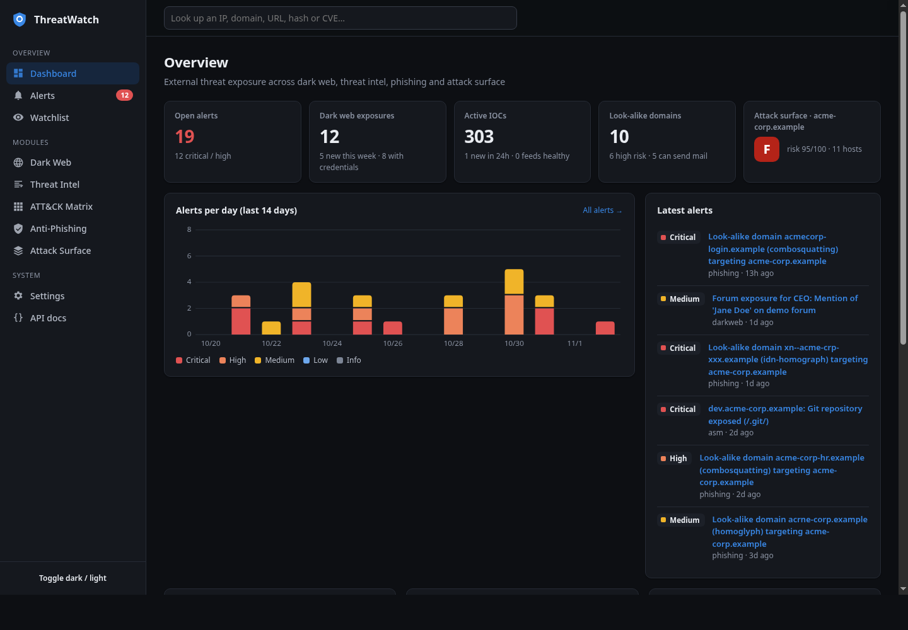
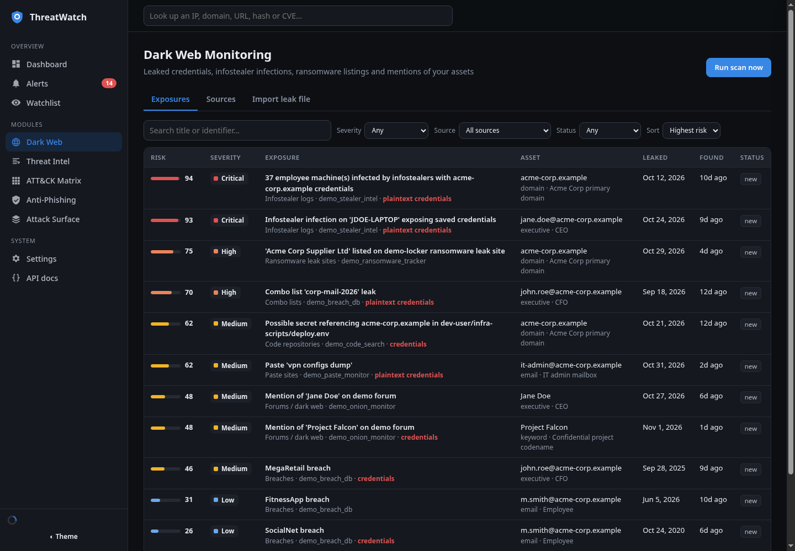
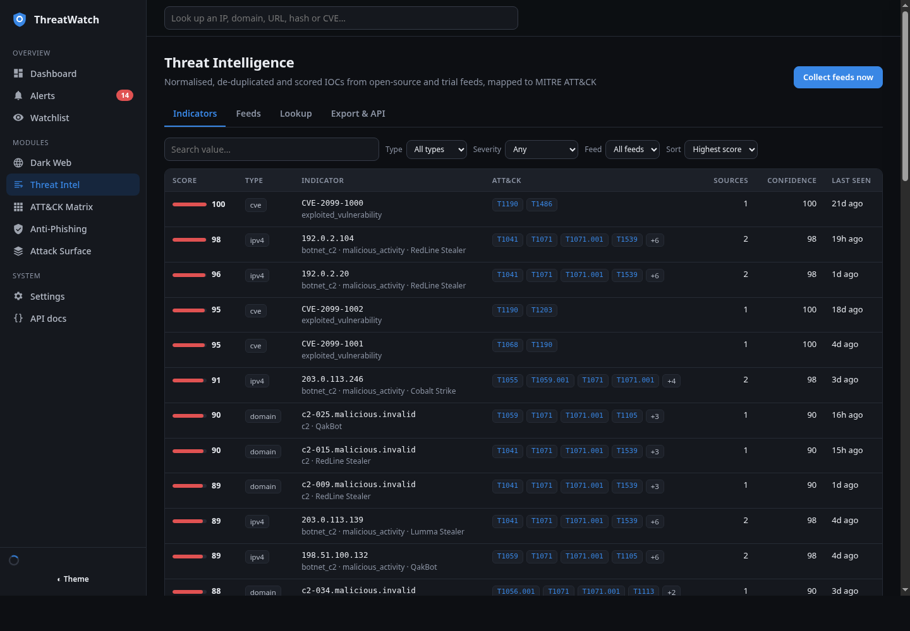
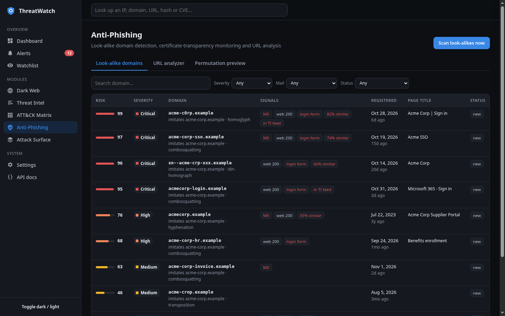
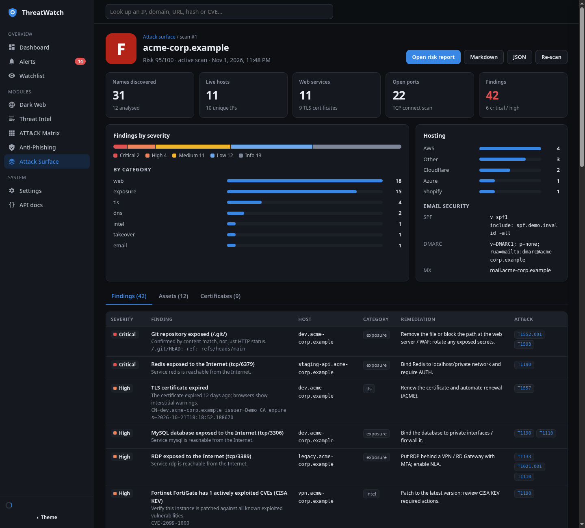

# ThreatWatch

**A standalone external threat-intelligence platform.** ThreatWatch watches the outside of your organisation the way an attacker would:

| Module | What it does |
|---|---|
| **Dark Web Monitoring** | Finds leaked credentials, infostealer infections, ransomware leak-site listings, pastes, code leaks and dark-web mentions of your **domains, employees, executives and brand**. Every exposure gets an explainable 0-100 risk score, and alerts fire above a threshold. |
| **Threat Intelligence Feed** | Collects IOCs from 10 free and 5 trial feeds, then **normalises, de-duplicates, scores and maps them to MITRE ATT&CK**. You can export them as **STIX 2.1**, JSON, CSV or a plain-text blocklist, or pull them from the REST API and a built-in **TAXII 2.1** server. |
| **Anti-Phishing** | Generates thousands of look-alike domains (typos, homoglyphs, IDN homographs, combosquats, TLD swaps), checks which are registered, and inspects their DNS, MX, website, content similarity, login forms and registration age. Also watches Certificate Transparency logs and analyses any URL on demand. |
| **Attack Surface Management** | Discovers sub-domains from CT logs, passive DNS, web archives and brute force. Fingerprints web services, analyses TLS certificates, optionally port-scans, and checks email/DNS hygiene and sub-domain takeover. Produces a graded **risk report** in HTML, Markdown or JSON. |

All four share one watchlist, one alerting pipeline and one web UI. The modules also feed each other:

- ASM flags hosts that appear in threat feeds, and products with CISA-KEV vulnerabilities.
- The phishing module boosts look-alikes that are already reported in feeds.
- Feed ingestion alerts when a phishing URL references your brand.



<table><tr>
<td></td>
<td></td>
</tr><tr>
<td></td>
<td></td>
</tr></table>

---

## Quick start

```bash
# 1. Install (Python 3.11+)
python3 -m venv .venv && .venv/bin/pip install -e ".[dev]"

# 2. Optional: explore with a fictional demo organisation first
.venv/bin/threatwatch seed-demo

# 3. Run
.venv/bin/threatwatch serve            # http://127.0.0.1:8000
```

Or with Docker:

```bash
cp .env.example .env                   # set TW_API_KEY at minimum
docker compose up -d                   # http://127.0.0.1:8000
```

Then go to **Watchlist**, add your primary domain, your executives (name + email addresses), key mailboxes and brand names, and press **Run scan** on each module. Feed collection, dark-web scans and look-alike scans then run on a schedule.

> **Before monitoring for real:** create an admin account (`threatwatch user add <name> --role admin`, or use the setup screen on first visit). Until a user or `TW_API_KEY` exists, the instance is open to anyone who can reach it. Only run *active* ASM scans against assets you own or are authorised to test. See [docs/SECURITY.md](docs/SECURITY.md).

## What works with zero API keys

| Area | Free, keyless sources |
|---|---|
| Dark web | XposedOrNot, LeakCheck public API, Hudson Rock Cavalier (infostealers), HIBP breach catalogue, ransomware.live |
| Threat intel | abuse.ch Feodo Tracker and SSL Blacklist, OpenPhish, Phishing Army, CINS Army, ET compromised IPs, blocklist.de, IPsum, Spamhaus DROP, CISA KEV |
| Phishing | DNS, RDAP, crt.sh, direct page inspection |
| ASM | crt.sh, CertSpotter, HackerTarget, Wayback Machine, Team Cymru ASN, DNS brute force |

Free or trial keys unlock more sources: HIBP accounts and pastes, Intelligence X, GitHub code search, abuse.ch ThreatFox/URLhaus/MalwareBazaar, AlienVault OTX, AbuseIPDB, and Tor `.onion` monitoring. See [docs/SOURCES.md](docs/SOURCES.md).

## CLI

Every module can run headless (cron, CI, SOAR):

```bash
threatwatch feeds [--feed openphish] [--list]          # collect TI feeds
threatwatch darkweb                                     # scan the watchlist against leak sources
threatwatch phishing --domain example.com               # look-alike scan
threatwatch analyze-url "https://suspicious.example/login"
threatwatch asm example.com --report report.html        # passive ASM + report
threatwatch asm example.com --active --i-am-authorized  # + port scan, sensitive paths, AXFR
threatwatch export --format stix --min-score 65 -o iocs.stix.json
threatwatch add-asset executive "Jane Doe" --email jane@example.com --criticality critical
threatwatch attack-sync                                 # full MITRE ATT&CK catalogue
threatwatch seed-demo [--reset]
threatwatch user add alice --role admin                 # also: list, passwd, role, disable, enable, delete
```

## Documentation

| Document | Contents |
|---|---|
| [docs/SETUP.md](docs/SETUP.md) | Installation (local, Docker, PostgreSQL, Tor), reverse proxy, systemd, first-run checklist |
| [docs/CONFIGURATION.md](docs/CONFIGURATION.md) | Every environment variable |
| [docs/ARCHITECTURE.md](docs/ARCHITECTURE.md) | Components, data flow, data model, design decisions, extension points |
| [docs/USER_GUIDE.md](docs/USER_GUIDE.md) | Using each module day to day; triage workflows |
| [docs/SCORING.md](docs/SCORING.md) | All risk models and the ATT&CK mapping rules, with formulas |
| [docs/DATA_FORMAT.md](docs/DATA_FORMAT.md) | STIX 2.1 mapping, `threatwatch.ioc.v1` JSON schema, CSV, ASM report format |
| [docs/API.md](docs/API.md) | REST API and TAXII 2.1 reference with examples (OpenAPI is served at `/api/docs`) |
| [docs/SOURCES.md](docs/SOURCES.md) | Every feed and connector, how to get keys, how to add your own |
| [docs/OPERATIONS.md](docs/OPERATIONS.md) | Scheduling, backups, retention, performance tuning, troubleshooting |
| [docs/SECURITY.md](docs/SECURITY.md) | Legal and ethical use, data handling, hardening |

## Tech stack

Python 3.11+, FastAPI, SQLAlchemy 2 (SQLite by default, PostgreSQL optional), httpx (async), dnspython and cryptography. The UI is dependency-free ES modules with no build step and no CDN, so it works offline and air-gapped. There are 64 automated tests (`make test`), including validation of exported STIX against the OASIS `stix2` library.

## Project layout

```
threatwatch/
  core/            shared: IOC normalisation, domains, DNS, HTTP, risk helpers, alerts, jobs
  modules/
    darkweb/       leak-source connectors, exposure scoring, leak-file importer
    intel/         feed definitions, ingestion pipeline, scoring, ATT&CK mapping, STIX/TAXII export
    phishing/      permutation engine, page analysis, RDAP, URL analyser
    asm/           discovery, probes (ports/TLS/HTTP), finding rules, report renderer
  api/             FastAPI routers
  web/             single-page UI (HTML/CSS/JS)
  data/            embedded ATT&CK subset, sub-domain wordlist
  cli.py, main.py, scheduler.py, demo.py
tests/             pytest suite
docs/              documentation
```

## License

MIT. Third-party feeds and APIs have their own terms; see [docs/SOURCES.md](docs/SOURCES.md).
