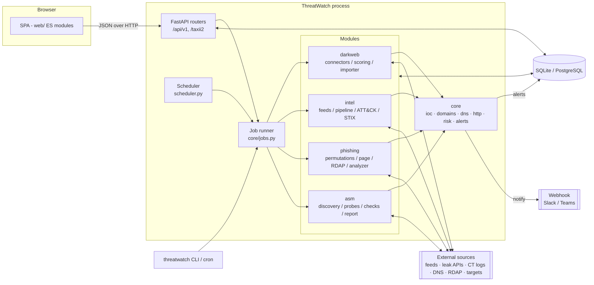
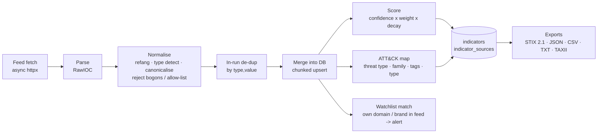
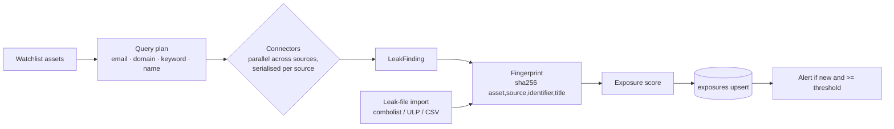
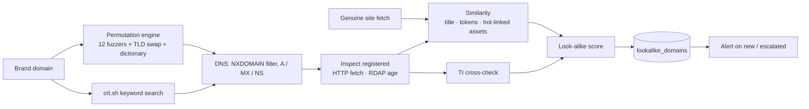
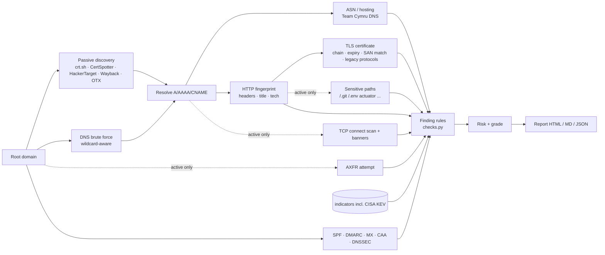
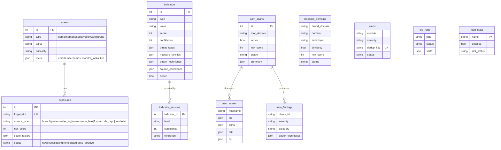

# Architecture

ThreatWatch is a single Python process. It serves the web UI and the REST/TAXII API, and runs collection jobs on its own event loop. One relational database holds all state. There is no message broker, worker fleet or JavaScript build. You can run it on a laptop, a VM or in one container, and grow into PostgreSQL behind a reverse proxy.

## 1. Component view

| Layer | Responsibility | Key files |
|---|---|---|
| UI | Hash-routed SPA; escapes all dynamic content; no external assets | `web/js/app.js`, `web/js/views/*.js`, `web/js/ui.js`, `web/js/charts.js` |
| API | Validation, auth (`X-API-Key`), pagination, export, TAXII 2.1 | `api/routes_*.py`, `api/common.py` |
| Jobs | Runs long tasks as asyncio tasks; records `job_runs`; one job per (kind, target); sends pending webhooks afterwards | `core/jobs.py` |
| Scheduler | Every 60 s, submits jobs whose interval has elapsed (last run read from `job_runs`, so restarts don't double-run) | `scheduler.py` |
| Modules | Domain logic per capability | `modules/*` |
| Core | Shared primitives: IOC normalisation, PSL-aware domain handling, async DNS, HTTP client factory (proxy and Tor), explainable scoring, de-duplicated alerting | `core/*` |
| Storage | SQLAlchemy 2 ORM; SQLite (WAL) by default, PostgreSQL supported | `models.py`, `db.py` |

## 2. Data flow per module

### 2.1 Threat intelligence pipeline

- **Normalisation** (`core/ioc.py`) guarantees one canonical `(type, value)` per indicator:
  - IPs are compressed and non-global addresses rejected.
  - Domains are lower-cased and IDNA-encoded, with trailing dots stripped.
  - URLs get a lower-case scheme and host, default ports removed and an explicit path.
  - Hashes are lower-cased and length-checked; CVE IDs are upper-cased.
- **De-duplication** happens twice: inside a feed run (dictionary keyed by `(type, value)`), and across feeds in the database (unique constraint plus merge). Each feed's sighting is kept in `indicator_sources`, so every indicator can explain *who* reported it and *when*.
- **Scoring and mapping** are recomputed whenever an indicator is touched. The formulas are in [SCORING.md](SCORING.md).
- **Retention**: indicators not seen for `TW_IOC_RETENTION_DAYS` are flagged `active = false`. Exports then mark them with `valid_until`; they are not deleted.

### 2.2 Dark web monitoring

- Each asset type expands into search terms. For example, an executive becomes their email addresses, their usernames as keywords, and their full name. See `service.query_plan`.
- Connectors run concurrently, but each holds a lock with a polite delay to respect source rate limits. One failing source never aborts a scan; errors are recorded in the job stats.
- **No plaintext secrets are persisted.** Connectors and the importer store only masked values (`h*****2`).

### 2.3 Anti-phishing

The URL analyser (`modules/phishing/analyzer.py`) reuses the same building blocks for a single URL: static URL features, brand impersonation against the watchlist, TI matches, the live page and the RDAP registration date.

### 2.4 Attack surface management

- **Passive mode** never sends anything a normal visitor wouldn't: DNS queries, one homepage GET and one TLS handshake per host.
- **Active mode** (port scan, sensitive-path probes, zone transfer) requires an explicit authorisation flag in both the API and the CLI.
- CDN edge IPs (Cloudflare, Akamai CDN, Fastly, Imperva) are only probed on web ports, because CDNs accept connections on many ports and would otherwise produce false "open port" findings.

## 3. Data model

Lists and nested structures are stored as JSON columns. SQLite and PostgreSQL both support them, which keeps the schema small and the API close to storage. Tables are created automatically at start-up (`create_all`); see [OPERATIONS.md](OPERATIONS.md#upgrades) for migrations.

## 4. Design decisions

| Decision | Rationale |
|---|---|
| **Single process, asyncio jobs** | The workloads are network-bound (APIs, DNS, TLS), and asyncio handles thousands of concurrent lookups in one process. Fewer moving parts make it truly standalone. Jobs record their state in the DB, so a restart marks interrupted jobs as failed instead of leaving them hanging. |
| **Sync SQLAlchemy inside async jobs** | Network I/O is awaited; database writes are short batched transactions. This avoids async-driver complexity and keeps PostgreSQL and SQLite on the same code path. |
| **Explainable, additive scoring** | Every score stores the factors that produced it (`score_factors`), and the UI shows them. Analysts can see *why* something is critical and tune the weights in one place. |
| **Rule-based ATT&CK mapping** | Deterministic and auditable, with no ML black box. Feeds that already carry technique IDs (OTX) are passed through. |
| **Deterministic STIX IDs** (UUIDv5) | Re-exports produce identical IDs, so downstream TIPs upsert rather than duplicate. |
| **PSL-aware domains with an offline snapshot** | Correct handling of `co.uk`-style suffixes with no runtime network dependency. Reserved and private TLDs (`.example`, `.internal`, `.corp`) are supported for internal domains. |
| **No build step, no CDN in the UI** | Works air-gapped; nothing to compile; the CSP-friendly static files are served by FastAPI. |
| **Masked secrets only** | A credential-exposure platform must not become a credential store. |
| **Active scanning behind explicit consent** | Port scanning without authorisation is illegal in many jurisdictions; the default is passive. |

## 5. Extension points

| To add... | Do this |
|---|---|
| A threat-intel feed | Write an `async def fetch_x(client, settings)` yielding `RawIOC` in `modules/intel/feeds.py` and register a `Feed(...)` in `FEEDS` with its reliability score. Normalisation, de-dup, scoring, mapping, export and UI listing come for free. |
| A dark-web / leak source | Subclass `Connector` in `modules/darkweb/connectors.py`: set `kinds` and `requires`, implement `_search` returning `LeakFinding`, and add the class to `CONNECTORS`. |
| An ATT&CK mapping rule | Edit `THREAT_TYPE_RULES`, `FAMILY_GROUPS` or `TAG_RULES` in `modules/intel/attack.py`. |
| An ASM check | Add a pure function to `modules/asm/checks.py` returning finding dicts, and call it from `_pipeline` in `modules/asm/service.py`. Pure functions are trivially unit-testable (see `tests/test_asm.py`). |
| A notification channel | Extend `core/alerts.notify_pending` (it currently posts Slack-compatible JSON). |
| A UI page | Add `web/js/views/<name>.js` exporting `render(main, ctx)` and register it in `ROUTES` in `web/js/app.js`. |

## 6. Scaling notes

- **SQLite** handles a few hundred thousand indicators comfortably (WAL mode, indexed `(type, value)`, chunked upserts). `TW_FEED_MAX_ITEMS` caps any single feed.
- **PostgreSQL** is recommended for multi-user deployments, more than about 1M indicators, or when other tools read the database. Change `TW_DATABASE_URL`; nothing else.
- **Horizontal scale**: run *one* instance with the scheduler enabled, plus any number of API-only instances (`TW_SCHEDULER_ENABLED=false`) behind a load balancer, sharing PostgreSQL. Jobs started from an API instance run in that instance.
- Heavy ASM scans can run from the CLI on a separate host against the same database.
